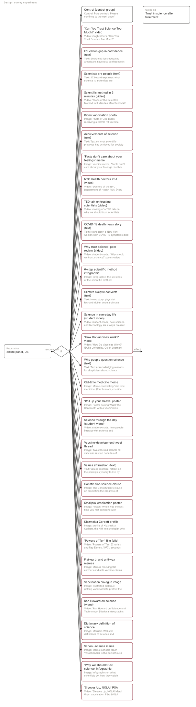
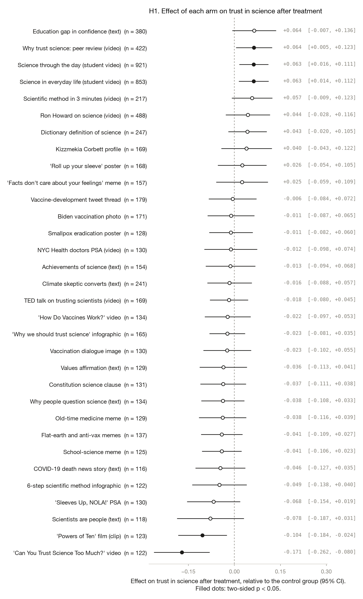

# Can Trust in Science Be Improved? An Adaptive Experiment Testing Student-Designed Messages

*Yamil R. Velez · 2026-10-09 · N = 8,572 analysed of 11,519 collected · survey experiment*

<!-- fd:badges -->
  [](https://osf.io/5yvh9)    

> **Provenance: FULLY AGENTIC — no human review recorded.** filedrawer 0.1.0, 2026-10-09; orchestrator `anthropic/claude-sonnet-5.5`, standard `anthropic/claude-haiku-5.5`, zero data retention requested. Reviewer pass: yes. Human steps recorded: 0. Release status: draft. Model calls: $0.71, 245k tokens in and 33k out. Cite as: Velez, Y. R. (2026). Can Trust in Science Be Improved? An Adaptive Experiment Testing Student-Designed Messages [Unpublished study package, generated with filedrawer 0.1.0]. The File Drawer. https://github.com/yrvelez/scientific-trust-messages

<!-- fd:section id=abstract -->
## Abstract

Can brief, student-designed messages raise trust in science? We ran a registered online survey experiment with US adults recruited through Lucid, randomly assigning respondents to one of 32 messages (videos, texts, memes, posters and infographics) or a pure control that only asked them to continue. Of 11,519 raw responses, 8,572 were analysed. Trust in science was measured after treatment on a scale where the control mean was 3.685. One video, 'Can You Trust Science Too Much?', lowered trust by 0.171 points (95% CI [−0.262, −0.080], p < 0.001), and the 'Powers of Ten' clip lowered it by 0.104 points. Three videos raised trust by roughly 0.06 points each: the peer-review video and two student-made videos. For the other arms the results were inconclusive; their intervals were wide and do not rule out small effects. Tests were uncorrected for multiplicity and several arms were small, so the modest findings should be read cautiously.

<!-- fd:section id=findings -->
## Key findings

- Most of the 32 messages were inconclusive against the pure control on trust in science; the few with uncorrected p < 0.05 moved it by small amounts.
- Registered: the 'Can You Trust Science Too Much?' video lowered trust in science by 0.171 scale points (95% CI [−0.262, −0.080], p < 0.001).
- Registered: three videos raised trust in science by about 0.06 scale points each, including both student-made videos (e.g. Science through the day, 95% CI [0.016, 0.111]).
- Caveat: 32 uncorrected two-sided tests, several arms with about 120 people, and effects near the threshold mean the smaller findings may be chance.

<!-- fd:section id=design -->
## Design and data

A survey experiment with 32 arms and a control group; online panel, US. 11,519 responses were collected and 8,572 are analysed after the exclusions `screener_pass == 1; arm.notna()`. The plan is pre-registered at https://osf.io/5yvh9. Identifier and free-text columns removed before any model saw the data: RecordedDate.



#### Details: the design in words

A survey experiment on online panel respondents in US (N = 8,572 analysed). Respondents are randomly assigned to 33 arms: 'Can You Trust Science Too Much?' video, Education gap in confidence (text), Scientists are people (text), Scientific method in 3 minutes (video), Biden vaccination photo, Achievements of science (text), 'Facts don't care about your feelings' meme, NYC Health doctors PSA (video), TED talk on trusting scientists (video), COVID-19 death news story (text), Why trust science: peer review (video), 6-step scientific method infographic, Climate skeptic converts (text), Science in everyday life (student video), 'How Do Vaccines Work?' video, Why people question science (text), Old-time medicine meme, 'Roll up your sleeve' poster, Science through the day (student video), Vaccine-development tweet thread, Values affirmation (text), Constitution science clause, Smallpox eradication poster, Kizzmekia Corbett profile, 'Powers of Ten' film (clip), Flat-earth and anti-vax memes, Vaccination dialogue image, Ron Howard on science (video), Dictionary definition of science, School-science meme, 'Why we should trust science' infographic, 'Sleeves Up, NOLA!' PSA, against the control group Control. 'Can You Trust Science Too Much?' video: Video: vlogbrothers, 'Can You Trust Science Too Much?': discusses the limits of science but concludes it is the best method we have Education gap in confidence (text): Text: Short text: less educated Americans have less confidence in science (Pew Research Center) Scientists are people (text): Text: 472-word explainer: what science is; scientists are fallible people who use observation and experiment Scientific method in 3 minutes (video): Video: 'Steps of the Scientific Method in 3 Minutes' (MooMooMath and Science) Biden vaccination photo: Image: Photo of Joe Biden receiving a COVID-19 vaccine Achievements of science (text): Text: Text on what scientific progress has achieved for society 'Facts don't care about your feelings' meme: Image: vaccine meme, "Facts don't care about your feelings. Neither does death" (50 million lives saved by vaccines) NYC Health doctors PSA (video): Video: 'Doctors of the NYC Department of Health PSA' (NYC Health) TED talk on trusting scientists (video): Video: closing of a TED talk on why we should trust scientists (car-reliability analogy; matches Naomi Oreskes, 'Why we should trust scientists', 2014) COVID-19 death news story (text): Text: News story: a New York woman with COVID-19 symptoms died after an untested drug cocktail Why trust science: peer review (video): Video: student-made, 'Why should we trust science?': peer review and expert credentials, over a PubMed screen recording 6-step scientific method infographic: Image: Infographic: the six steps of the scientific method Climate skeptic converts (text): Text: News story: physicist Richard Muller, once a climate skeptic, concludes humans cause global warming Science in everyday life (student video): Video: student-made, how science and technology are always present in our lives (29 s) 'How Do Vaccines Work?' video: Video: 'How Do Vaccines Work?' (Duke University, Quick Learner) Why people question science (text): Text: Text acknowledging reasons for skepticism about science during COVID-19 Old-time medicine meme: Image: Meme contrasting 'old-time medicine' (four humors, cocaine drops) with modern medicine 'Roll up your sleeve' poster: Image: Poster pairing WWII 'We Can Do It!' with a vaccination appeal: 'Trust the science' Science through the day (student video): Video: student-made, how people interact with science and technology over the course of their days Vaccine-development tweet thread: Image: Tweet thread: COVID-19 vaccines rest on decades of science and standard trials Values affirmation (text): Text: Values exercise: reflect on the principles you try to live by Constitution science clause: Image: The Constitution's clause on promoting the progress of science (Art. I, Sec. 8) Smallpox eradication poster: Image: Poster: 'When was the last time you met someone with smallpox? Science changes lives' Kizzmekia Corbett profile: Image: profile of Kizzmekia Corbett, the NIH immunologist who helped develop the Moderna COVID-19 vaccine, with vaccine tips 'Powers of Ten' film (clip): Video: 'Powers of Ten' (Charles and Ray Eames, 1977), seconds 10-120: zooms out from a picnic to the scale of the universe Flat-earth and anti-vax memes: Image: Memes mocking flat earthers and anti-vaccine claims Vaccination dialogue image: Image: Illustrated dialogue: getting vaccinated to protect the relationships you value Ron Howard on science (video): Video: 'Ron Howard on Science and Technology' (National Geographic, Breakthrough) Dictionary definition of science: Image: Merriam-Webster definitions of science and scientist School-science meme: Image: Meme: schools teach 'mitochondria is the powerhouse of the cell' 'Why we should trust science' infographic: Image: infographic on what scientists do, how they catch mistakes, and discoveries that changed the world 'Sleeves Up, NOLA!' PSA: Video: 'Sleeves Up, NOLA! Mardi Gras' vaccination PSA (NOLA Ready) Outcome: Trust in science after treatment.


The plan was registered on OSF, with later amendments covering the assignment algorithm and covariate adjustment. The sample is US adults from Lucid. There were 11,519 raw responses and 8,572 in the analysis; the model for H1 used 7,803 rows with complete data. Arms were assigned adaptively, so arm sizes vary widely, from about 116 to 921 respondents. Each message is compared with the pure control. The outcome is trust in science measured after treatment, with a control mean of 3.685.

<!-- fd:section id=results -->
## Results

<!-- fd:hyp id=H1 tag=registered outcome=post_trust -->
### H1. Trust in science after treatment

*Registered: the effect of each of the 32 messages on trust in science, relative to the pure control.*  
*Pre-registered.*



Five of the 32 messages had uncorrected two-sided p < 0.05. The 'Can You Trust Science Too Much?' video lowered trust by 0.171 points (95% CI [−0.262, −0.080], p < 0.001), and the 'Powers of Ten' clip by 0.104 points (95% CI [−0.184, −0.024], p = 0.010). Three videos raised it by about 0.06 points: Science through the day (95% CI [0.016, 0.111], p = 0.009), Science in everyday life (95% CI [0.014, 0.112], p = 0.012) and the peer-review video (95% CI [0.005, 0.123], p = 0.034). The remaining arms had intervals including zero, so they are inconclusive rather than shown to be ineffective. With 32 uncorrected tests, the p-values near 0.03 deserve particular caution.

#### Details: model and estimates by arm (H1)

```
post_trust ~ C(arm_code, Treatment(reference='A1')) * (pre_trust_c + age_c + education_c + white_c + latino_c + dem_c + rep_c)
Lin (2013) covariate adjustment | weights = ipw | HC2 robust SEs | N = 7803 | two-sided test, alpha = 0.05
```

| Arm | Estimate | SE | p | 95% CI | n (arm) | Supported |
|---|---|---|---|---|---|---|
| 'Can You Trust Science Too Much?' video | -0.171 | 0.046 | 0.0002 | [-0.262, -0.080] | 122 | yes |
| Education gap in confidence (text) | 0.064 | 0.036 | 0.0770 | [-0.007, 0.136] | 380 | no |
| Scientists are people (text) | -0.078 | 0.056 | 0.1594 | [-0.187, 0.031] | 118 | no |
| Scientific method in 3 minutes (video) | 0.057 | 0.034 | 0.0878 | [-0.009, 0.123] | 217 | no |
| Biden vaccination photo | -0.011 | 0.039 | 0.7803 | [-0.087, 0.065] | 171 | no |
| Achievements of science (text) | -0.013 | 0.041 | 0.7558 | [-0.094, 0.068] | 154 | no |
| 'Facts don't care about your feelings' meme | 0.025 | 0.043 | 0.5584 | [-0.059, 0.109] | 157 | no |
| NYC Health doctors PSA (video) | -0.012 | 0.044 | 0.7880 | [-0.098, 0.074] | 130 | no |
| TED talk on trusting scientists (video) | -0.018 | 0.032 | 0.5794 | [-0.080, 0.045] | 169 | no |
| COVID-19 death news story (text) | -0.046 | 0.042 | 0.2668 | [-0.127, 0.035] | 116 | no |
| Why trust science: peer review (video) | 0.064 | 0.030 | 0.0341 | [0.005, 0.123] | 422 | yes |
| 6-step scientific method infographic | -0.049 | 0.045 | 0.2833 | [-0.138, 0.040] | 122 | no |
| Climate skeptic converts (text) | -0.016 | 0.037 | 0.6686 | [-0.088, 0.057] | 241 | no |
| Science in everyday life (student video) | 0.063 | 0.025 | 0.0116 | [0.014, 0.112] | 853 | yes |
| 'How Do Vaccines Work?' video | -0.022 | 0.038 | 0.5677 | [-0.097, 0.053] | 134 | no |
| Why people question science (text) | -0.038 | 0.036 | 0.2950 | [-0.108, 0.033] | 134 | no |
| Old-time medicine meme | -0.038 | 0.039 | 0.3285 | [-0.116, 0.039] | 129 | no |
| 'Roll up your sleeve' poster | 0.026 | 0.041 | 0.5288 | [-0.054, 0.105] | 168 | no |
| Science through the day (student video) | 0.063 | 0.024 | 0.0093 | [0.016, 0.111] | 921 | yes |
| Vaccine-development tweet thread | -0.006 | 0.040 | 0.8832 | [-0.084, 0.072] | 179 | no |
| Values affirmation (text) | -0.036 | 0.039 | 0.3600 | [-0.113, 0.041] | 129 | no |
| Constitution science clause | -0.037 | 0.038 | 0.3342 | [-0.111, 0.038] | 131 | no |
| Smallpox eradication poster | -0.011 | 0.036 | 0.7537 | [-0.082, 0.060] | 128 | no |
| Kizzmekia Corbett profile | 0.040 | 0.042 | 0.3457 | [-0.043, 0.122] | 169 | no |
| 'Powers of Ten' film (clip) | -0.104 | 0.041 | 0.0104 | [-0.184, -0.024] | 123 | yes |
| Flat-earth and anti-vax memes | -0.041 | 0.035 | 0.2355 | [-0.109, 0.027] | 137 | no |
| Vaccination dialogue image | -0.023 | 0.040 | 0.5585 | [-0.102, 0.055] | 130 | no |
| Ron Howard on science (video) | 0.044 | 0.037 | 0.2315 | [-0.028, 0.116] | 488 | no |
| Dictionary definition of science | 0.043 | 0.032 | 0.1815 | [-0.020, 0.105] | 247 | no |
| School-science meme | -0.041 | 0.033 | 0.2125 | [-0.106, 0.023] | 125 | no |
| 'Why we should trust science' infographic | -0.023 | 0.030 | 0.4337 | [-0.081, 0.035] | 165 | no |
| 'Sleeves Up, NOLA!' PSA | -0.068 | 0.044 | 0.1269 | [-0.154, 0.019] | 130 | no |

<!-- fd:section id=exploratory -->
## Exploratory analyses

*Everything in this section is exploratory and was not pre-registered.*

<!-- fd:hyp id=E1 tag=exploratory kind=pipeline -->
### E1. Planned H1 estimates restricted to finished responses

Unfinished responses make up a sizeable share of the sample, so the planned arm contrasts are re-estimated on completed surveys to check that the registered pattern does not depend on partial responses. The planned treatment-versus-control comparisons on trust in science were re-estimated with the same specification on the subset of respondents who finished the survey, and the arm estimates and standard errors were set side by side with the original ones.

**Finding.** The finished-only sample is the same 7,803 respondents as the main model (every analysed respondent finished the survey), so all 32 arm estimates and standard errors are identical, with 5 arms significant at p<0.05 in both. The check cannot test sensitivity to partial completion.

Exploratory, unreviewed code: the finished-only subset equals the analysed sample (7,803 rows in both), so the check is uninformative about whether incomplete responses matter.

#### Details: table (E1)

| term | arm | estimate_original | std_error_original | p_value_original | n_original | estimate_finished_only | std_error_finished_only | p_value_finished_only | n_finished_only | se_ratio |
|---|---|---|---|---|---|---|---|---|---|---|
| C(arm_code, Treatment(reference='A1'))[T.A2] | 'Can You Trust Science Too Much?' video | -0.171 | 0.046 | 0.000222 | 7803 | -0.171 | 0.046 | 0.000222 | 7803 | 1 |
| C(arm_code, Treatment(reference='A1'))[T.A3] | Education gap in confidence (text) | 0.064 | 0.036 | 0.077 | 7803 | 0.064 | 0.036 | 0.077 | 7803 | 1 |
| C(arm_code, Treatment(reference='A1'))[T.A4] | Scientists are people (text) | -0.078 | 0.056 | 0.159 | 7803 | -0.078 | 0.056 | 0.159 | 7803 | 1 |
| C(arm_code, Treatment(reference='A1'))[T.A5] | Scientific method in 3 minutes (video) | 0.057 | 0.034 | 0.088 | 7803 | 0.057 | 0.034 | 0.088 | 7803 | 1 |
| C(arm_code, Treatment(reference='A1'))[T.A6] | Biden vaccination photo | -0.011 | 0.039 | 0.780 | 7803 | -0.011 | 0.039 | 0.780 | 7803 | 1 |
| C(arm_code, Treatment(reference='A1'))[T.A7] | Achievements of science (text) | -0.013 | 0.041 | 0.756 | 7803 | -0.013 | 0.041 | 0.756 | 7803 | 1 |
| C(arm_code, Treatment(reference='A1'))[T.A8] | 'Facts don't care about your feelings' meme | 0.025 | 0.043 | 0.558 | 7803 | 0.025 | 0.043 | 0.558 | 7803 | 1 |
| C(arm_code, Treatment(reference='A1'))[T.A9] | NYC Health doctors PSA (video) | -0.012 | 0.044 | 0.788 | 7803 | -0.012 | 0.044 | 0.788 | 7803 | 1 |
| C(arm_code, Treatment(reference='A1'))[T.A10] | TED talk on trusting scientists (video) | -0.018 | 0.032 | 0.579 | 7803 | -0.018 | 0.032 | 0.579 | 7803 | 1 |
| C(arm_code, Treatment(reference='A1'))[T.A11] | COVID-19 death news story (text) | -0.046 | 0.042 | 0.267 | 7803 | -0.046 | 0.042 | 0.267 | 7803 | 1 |
| C(arm_code, Treatment(reference='A1'))[T.A12] | Why trust science: peer review (video) | 0.064 | 0.030 | 0.034 | 7803 | 0.064 | 0.030 | 0.034 | 7803 | 1 |
| C(arm_code, Treatment(reference='A1'))[T.A13] | 6-step scientific method infographic | -0.049 | 0.045 | 0.283 | 7803 | -0.049 | 0.045 | 0.283 | 7803 | 1 |
| … 20 more rows |  | | | | | | | | | |

<!-- fd:hyp id=E2 tag=exploratory kind=pipeline -->
### E2. Heterogeneity of planned H1 arm effects by Republican identification

Partisanship is the most likely source of variation in trust in science, so the planned arm contrasts are checked for differences between Republicans and non-Republicans. The planned treatment-versus-control comparisons were re-estimated with an interaction between each arm and a 0/1 indicator of Republican identification, and the interaction estimates were tabulated.

**Finding.** One of 32 arm-by-Republican interactions is significant at p<0.05: the everyday-science student video (Science in everyday life) raised trust about 0.17 points more among Republicans (p = 0.004). Three text messages have interactions with p between 0.05 and 0.08. With 32 uncorrected tests, this is a lead for follow-up, not evidence of partisan heterogeneity overall.

Exploratory, unreviewed code: one arm-by-Republican-identification interaction was significant at p < 0.05, and the others were imprecise. Partisan differences are therefore not established.

#### Details: table (E2)

| term | arm | estimate | std_error | p_value | conf_low | conf_high | n |
|---|---|---|---|---|---|---|---|
| C(arm_code, Treatment(reference='A1'))[T.A2]:C(_mod)[T.1] | 'Can You Trust Science Too Much?' video x rep=1 | 0.191 | 0.140 | 0.173 | -0.084 | 0.467 | 7803 |
| C(arm_code, Treatment(reference='A1'))[T.A3]:C(_mod)[T.1] | Education gap in confidence (text) x rep=1 | 0.094 | 0.079 | 0.237 | -0.062 | 0.249 | 7803 |
| C(arm_code, Treatment(reference='A1'))[T.A4]:C(_mod)[T.1] | Scientists are people (text) x rep=1 | -0.012 | 0.098 | 0.907 | -0.204 | 0.181 | 7803 |
| C(arm_code, Treatment(reference='A1'))[T.A5]:C(_mod)[T.1] | Scientific method in 3 minutes (video) x rep=1 | 0.045 | 0.083 | 0.590 | -0.118 | 0.208 | 7803 |
| C(arm_code, Treatment(reference='A1'))[T.A6]:C(_mod)[T.1] | Biden vaccination photo x rep=1 | 0.100 | 0.084 | 0.232 | -0.064 | 0.264 | 7803 |
| C(arm_code, Treatment(reference='A1'))[T.A7]:C(_mod)[T.1] | Achievements of science (text) x rep=1 | 0.031 | 0.110 | 0.782 | -0.186 | 0.247 | 7803 |
| C(arm_code, Treatment(reference='A1'))[T.A8]:C(_mod)[T.1] | 'Facts don't care about your feelings' meme x rep=1 | 0.104 | 0.080 | 0.196 | -0.054 | 0.261 | 7803 |
| C(arm_code, Treatment(reference='A1'))[T.A9]:C(_mod)[T.1] | NYC Health doctors PSA (video) x rep=1 | -0.101 | 0.084 | 0.230 | -0.266 | 0.064 | 7803 |
| C(arm_code, Treatment(reference='A1'))[T.A10]:C(_mod)[T.1] | TED talk on trusting scientists (video) x rep=1 | 0.038 | 0.076 | 0.618 | -0.111 | 0.187 | 7803 |
| C(arm_code, Treatment(reference='A1'))[T.A11]:C(_mod)[T.1] | COVID-19 death news story (text) x rep=1 | 0.120 | 0.082 | 0.142 | -0.040 | 0.280 | 7803 |
| C(arm_code, Treatment(reference='A1'))[T.A12]:C(_mod)[T.1] | Why trust science: peer review (video) x rep=1 | -0.004 | 0.067 | 0.957 | -0.134 | 0.127 | 7803 |
| C(arm_code, Treatment(reference='A1'))[T.A13]:C(_mod)[T.1] | 6-step scientific method infographic x rep=1 | -0.099 | 0.094 | 0.294 | -0.284 | 0.086 | 7803 |
| … 20 more rows |  | | | | | | |


<!-- fd:section id=related -->
## Related work

The retrieved literature on the hypothesis is thin. Van Bavel et al. (2020) argue that social and behavioural science should inform the COVID-19 pandemic response, which gives general backing to testing whether brief messages can shape public attitudes toward science. Ecker et al. (2022) review the psychological drivers of misinformation belief and its resistance to correction, which bears on whether any single message can move trust in science relative to a pure control. Berinsky et al. (2012) assess the internal and external validity of experiments run on Amazon Mechanical Turk, a relevant reference for an online randomised design. The main tension is between the expectation that messages can shift trust and Ecker et al.'s account of how resistant beliefs are to correction. Van Bavel et al. take the policy case for behavioural interventions as given, while Ecker et al. suggest that changing entrenched beliefs is hard. A design with 32 messages against a pure control can test whether any message departs from control, which speaks directly to this disagreement. Berinsky et al.'s validity concerns mean that any such effects would need to be read with the sample's limits in mind.

Retrieved works (OpenAlex; queries: trust in science persuasive messages experiment; science messaging intervention improves trust vaccine; trust in science interventions null effects; backfire effect corrective messages science skepticism; adaptive multi-arm bandit survey experiment messaging):

- Jay Joseph Van Bavel, Katherine Baicker, Paulo S. Boggio, Valerio Capraro (2020). Using social and behavioural science to support COVID-19 pandemic response. Nature Human Behaviour. https://doi.org/10.1038/s41562-020-0884-z
- Adam J. Berinsky, Gregory A. Huber, Gabriel S. Lenz (2012). Evaluating Online Labor Markets for Experimental Research: Amazon.com's Mechanical Turk. Political Analysis. https://doi.org/10.1093/pan/mpr057
- Ullrich K. H. Ecker, Stephan Lewandowsky, John Cook, Philipp Schmid (2022). The psychological drivers of misinformation belief and its resistance to correction. Nature Reviews Psychology. https://doi.org/10.1038/s44159-021-00006-y

<!-- fd:section id=limitations -->
## Limitations

Thirty-two two-sided tests were run without correction for multiplicity, so some of the five effects with p < 0.05 may be false positives, especially those with p near 0.03. Adaptive assignment left some arms with only about 120 respondents, giving wide intervals. The effects are small, at most about 0.17 points on the trust scale, and only trust measured right after exposure is observed, so durability is unknown. Lucid is an online panel, so results may not generalise beyond it. Several messages differ in format, length and content, so the design cannot say which feature drives an effect.

<!-- fd:section id=review round=1 -->
## Review

*Light Pass review: referee `anthropic/claude-sonnet-5.5`, checking agent `anthropic/claude-sonnet-5.5`. The Light Pass does two things: it checks every reported estimate against the result tables, and every analysis against the pre-analysis plan. It does not judge the design, methods or interpretation; see the other review options. The agent applied the corrections below itself; no person reviewed or revised this report. Registered analyses are never changed.*

**Outcome.** 11 of 11 checked claims supported after the agent's corrections (4 flagged claims corrected); 1 of 1 registered analyses run as planned; 4 reworded; 2 text fixes; 2 correction passes.

#### Corrections

- **Corrected** · 6 items reworded or fixed in the text: Abstract, H1, E1, E2, R1, E1, R2, E2. Before and after are in the log below.

#### Details: full review log

Models: referee `anthropic/claude-sonnet-5.5`, checking agent `anthropic/claude-sonnet-5.5`.

**Assessment.** The H1 estimates in the prose match the registered tables: five of 32 arms have p < 0.05, one negative large video, one negative clip, and three positive videos of about 0.06. The report correctly flags that the tests are uncorrected, but some wording is too strong, notably 'Registered' labels for specific arm effects. E1 is uninformative and its 7.5% dropped-rows claim contradicts the table. The most important caveat is that five of 32 uncorrected tests, with p near 0.01-0.03 for four of them, is only modestly above the roughly 1.6 expected by chance.

| Registered analysis | Against the plan | Differences | Stated reason |
|---|---|---|---|
| H1 | as planned | — | — |

| Issue | Severity | Kind | Source | Outcome | What the referee said |
|---|---|---|---|---|---|
| K3 | high | presentational | claims | Fixed in text | E1: Unsupported claim: "Restricting to finished responses (dropping 7.5% of rows) left all 32 arm estimates unchanged". E1 table: n_original = n_finished_only = 7803 for every arm, so no rows were dropped; the check is uninformative. *claim checked against the tables by the checking agent* |
| K1 | medium | presentational | claims | Fixed in text | Abstract: Overstated claim: "The other arms were not distinguishable from control". 27 arms have p > 0.05, but their intervals are wide (e.g. A3 0.064, p=0.077) and cannot rule out small effects. *claim checked against the tables by the checking agent* |
| K2 | medium | presentational | claims | Fixed in text | H1: Overstated claim: "Five of the 32 messages differed from control". 5 of 32 have p < 0.05 uncorrected (summary line); about 1.6 are expected by chance. *claim checked against the tables by the checking agent* |
| K4 | medium | presentational | claims | Fixed in text | E2: Overstated claim: "no clear partisan heterogeneity". The one significant interaction (0.165, p=0.004) is for a headline arm, and several others have p between 0.05 and 0.09. *claim checked against the tables by the checking agent* |
| R1 | medium | presentational | light | Fixed in text | E1: Text says 7.5% of rows were dropped and that unfinished responses are 'a sizeable share', but the E1 table shows n_original = n_finished_only = 7803 for every arm, so no rows were dropped. The estimates, SEs and p-values are identical because the sample did not change. *The 7.5% text contradicts the identical n in the E1 table, so the text needs correcting.* |
| R2 | medium | presentational | light | Fixed in text | E2: The text says 1 of 32 interactions has p<0.05. Only 12 of the 32 rows are visible, and none of them has p<0.05 (the smallest is 0.142). The count appears in no visible table. *The summary line over all rows supports the count of 1 of 32, so the prose should cite the full table and name the arm.* |
| R3 | low | presentational | light | Fixed in text | Abstract / H1: The text says 'p < 0.001' for the Can You Trust Science Too Much? video, but the table gives p = 0.000222. This is consistent, but the H1 prose gives other p-values to three decimals. *Cosmetic p-value formatting.* |
| R4 | low | presentational | light | Fixed in text | Abstract / H1: The text says three videos raised trust by 'roughly 0.06' each. The tables give 0.063, 0.063 and 0.064, which fits. Science in everyday life has p = 0.0116 and its CI matches. The Powers of Ten p of 0.010 matches 0.0104. *The reviewer notes no change is needed.* |

| Claim | Where | Verdict | Evidence | After corrections |
|---|---|---|---|---|
| One video, 'Can You Trust Science Too Much?', lowered trust by 0.171 points (95% CI [−0.262, −0.080], p < 0.001) | Abstract | supported | H1_arms A2: -0.171, CI [-0.262,-0.080], p=0.000222. | supported: One video, 'Can You Trust Science Too Much?', lowered trust by 0.171 points (95% CI [−0.262, −0.080], p < 0.001) |
| the 'Powers of Ten' clip lowered it by 0.104 points | Abstract | supported | H1_arms A26: -0.104, p=0.010, CI [-0.184,-0.024]. | supported: the 'Powers of Ten' clip lowered it by 0.104 points |
| Three videos raised trust by roughly 0.06 points each | Abstract | supported | A12 0.064, A15 0.063, A20 0.063; p = 0.034, 0.012, 0.009. | supported: Three videos raised trust by roughly 0.06 points each: the peer-review video and two student-made videos |
| The other arms were not distinguishable from control | Abstract | overstated | 27 arms have p > 0.05, but their intervals are wide (e.g. A3 0.064, p=0.077) and cannot rule out small effects. | supported: For the other arms the results were inconclusive; their intervals were wide and do not rule out small effects. |
| Registered: three videos raised trust ... including both student-made videos | Key findings | supported | A15 and A20 are the student-made videos; A12 is also described as student-made, so all three are student-made, not two of three. | supported: Registered: three videos raised trust in science by about 0.06 scale points each, including both student-made videos |
| Five of the 32 messages differed from control | H1 | overstated | 5 of 32 have p < 0.05 uncorrected (summary line); about 1.6 are expected by chance. | supported: Five of the 32 messages had uncorrected two-sided p < 0.05. |
| Restricting to finished responses (dropping 7.5% of rows) left all 32 arm estimates unchanged | E1 | unsupported | E1 table: n_original = n_finished_only = 7803 for every arm, so no rows were dropped; the check is uninformative. | supported: The finished-only sample is the same 7,803 respondents as the main model, so all 32 arm estimates and standard errors are identical. The check cannot test sensitivity to partial completion. |
| Only 1 of 32 arm-by-Republican interaction estimates has p<0.05 | E2 | supported | E2 summary line: 1 of 32, smallest p 0.003677 (Science in everyday life x rep=1; row A15 shows 0.004). | supported: One of 32 arm-by-Republican interactions is significant at p<0.05: Science in everyday life raised trust about 0.17 points more among Republicans (p = 0.004) |
| no clear partisan heterogeneity | E2 | overstated | The one significant interaction (0.165, p=0.004) is for a headline arm, and several others have p between 0.05 and 0.09. | supported: this is a lead for follow-up, not evidence of partisan heterogeneity overall |

Re-check of the corrected text: No rewording is needed; the previous overstatements and the E1 error are fixed.

#### Other review options

- **Coarse**: the open-source coarse-ink reviewer, run on your machine (about $1-2), then imported. `uvx coarse-ink review report.md, then filedrawer review-import . coarse FILE`
- **Refine**: upload the report to refine.ink, then import its review. `filedrawer review-import . refine FILE`
- **OpenReview or any referee report**: import a review posted on OpenReview, or any other referee report. `filedrawer review-import . openreview FILE`


<!-- fd:section id=potential -->
## Research potential

*The agent's assessment of what this study can still become. The proposed extensions below are built from it.*

**What stands.** Pre-registered design with documented amendments (assignment algorithm, Lin covariate adjustment) and a pure control, so each of the 32 messages is a clean randomized contrast. Broad stimulus set (videos, text, memes, posters, infographics), including student-made messages, with a pre-treatment trust covariate that tightens intervals (SEs of about 0.025-0.046). Honest reporting: non-significant arms are called inconclusive, and the multiplicity and small-arm caveats are stated. The student-made videos 'Science through the day' (n=921) and 'Science in everyday life' (n=853) were the best-powered arms and gave consistent estimates (0.063 each), so they are the most credible positive result.

**Verdict.** A follow-up is worth running, but a narrow one. The study's main result is that most messages do nothing detectable. Only the 'Can You Trust Science Too Much?' video survives multiplicity, and its negative effect (-0.171) is more credible than the gains of about 0.06. Run the replication of the two student videos with a delayed and a behavioural outcome first, because it tests the only consistent positive signal at adequate power. Then run the format-versus-content test and the partisanship moderation test. The literature retrieved is thin, so the debate is only loosely anchored.

#### Details: why it may not have landed, and the debates it bears on

**Why it may not have landed.**

| Cause | What happened | Evidence |
|---|---|---|
| Statistical power | Adaptive assignment left most arms at about 116-180 respondents against a control of 664. Intervals are too wide to rule out effects of 0.1 for most arms, and the positive effects are close to the noise floor. | Arm n of 116-180 with SEs of 0.035-0.056. The control has n=664, and the peer-review video has p=0.034. |
| Analysis | Thirty-two uncorrected two-sided tests were run, and 5 reached p<0.05, roughly the 1.6 expected by chance. Only the 'Can You Trust Science Too Much?' video (p=0.0002) clearly survives a Bonferroni threshold of about 0.0016. | H1 table: p=0.034, 0.012, 0.009 and 0.010 for the other four significant arms. |
| Measurement | Trust is a single post-treatment measure with a ceiling-like control mean of 3.685. Effects of about 0.06 are tiny, and durability is unknown. | Control mean 3.685. Largest effect -0.171. The Limitations section says only immediate trust is observed. |
| Design | The arms vary in format, length and content at once, so no active ingredient can be identified. The positive student videos are also short and generic. | Student videos last about 29 s. The negative arms are a limits-of-science video and a 'Powers of Ten' clip. |
| A moderator not measured | The exploratory partisan check suggests heterogeneity in at least one arm, but the study was not powered to test it. | E2: the Science in everyday life interaction with Republican identification is 0.165 (p=0.004). Climate skeptic converts is 0.178 (p=0.053). 'Can You Trust Science Too Much?' is 0.191 (p=0.173). |

**D1. Can brief messages move trust in science?.** (a) Brief, well-designed messages and behavioural interventions can shift public attitudes toward science. [Bavel et al. (2020)] (b) Entrenched beliefs resist correction, so single brief messages leave trust largely unchanged relative to control. [Ecker et al. (2022)] This study: The evidence leans toward position b. Most of the 32 messages are inconclusive, and the significant effects are at most 0.06 points up and 0.17 down. Small positive shifts from short student videos cannot be ruled out, but they are not robust to multiplicity.


<!-- fd:section id=extensions -->
## Proposed extensions

*3 follow-up studies proposed by the agent. Proposals, not findings. Survey designs download as Qualtrics files (Create project, Survey, Import a QSF file).*

<!-- fd:ext id=advance_design kind=mechanism label=advance_design -->
### Design advance: Replicating the short student videos with a delayed follow-up and a behavioural outcome

Addresses power and measurement. It concentrates the sample on the two best-supported arms plus the peer-review video, tests them against control in a confirmatory design, and adds a delayed and a behavioural outcome.

**Hypothesis.** Each video raises immediate trust relative to control (position a). Under position b, contrasts are near zero after Holm correction. Effects at 7 days are smaller than or equal to immediate effects.

**Design.** Control vs. Science through the day vs. Science in everyday life vs. Peer review video; primary outcome: Immediate post-treatment trust in science (mean of 6 items, items 4-6 reverse-coded), with 7-day trust and the behavioural choice as secondary outcomes. About 4000 per arm for 80% power.

Files: [`extensions/advance_design.qsf`](extensions/advance_design.qsf) · [diagram](extensions/advance_design.svg) · [plain-text description](extensions/advance_design.txt)

#### Details: background and open items

In the source study, Science through the day (about 0.06, SE 0.025) and Science in everyday life (0.063, SE 0.025) were near the threshold among 32 uncorrected tests. The peer-review video had 0.064 (p=0.034). Only immediate trust was measured, so durability and behavioural carry-over are unknown. This confirmatory test concentrates the sample on those three videos plus control and adds a 7-day and a behavioural outcome.

**Debate it speaks to.** Can brief messages move trust in science?: Brief, well-designed messages and behavioural interventions can shift public attitudes toward science. versus Entrenched beliefs resist correction, so single brief messages leave trust largely unchanged relative to control.

**Power.** About 4000 per arm to detect 0.03 at 80% power (Observed effect of about 0.063 (SE 0.025 at n=853-921). The power table was empty, so the sample size is a back-of-envelope estimate of about 1,000 per arm for 80% power at 0.063. 4,000 per arm gives headroom to detect effects of about half that size and for attrition in the delayed wave.).

Open items before fielding:

- Video files and hosting must be supplied by the research team.
- IRB number, compensation and bonus funding are to be set by the research team.
- Choice of donation recipient organisation.
- Supply media: video_day: video stimulus to supply (student-made video showing how people interact with science and technology over )
- Supply media: video_everyday: video stimulus to supply (student-made video on science and technology always present in our lives, 29 sec)
- Supply media: video_peer: video stimulus to supply (student-made video 'Why should we trust science?' on peer review and expert cred)

<!-- fd:ext id=generalizability_conditional kind=boundary label=generalizability_conditional -->
### Generalizability: Does partisanship moderate the student-video effect?

Addresses the missing moderator and the sample. The exploratory interaction of 0.165 in the Science in everyday life arm is untested confirmatory, and partisan effects bear on where the result holds.

**Hypothesis.** The video raises trust more among Republican-leaning respondents than among non-Republicans (positive interaction). Under the null (position b) the interaction and the main effect are near zero.

**Design.** Control vs. Science in everyday life video; primary outcome: Trust in science: mean of the 6 post-treatment items, items 4-6 reverse-coded. About 2500 per arm for 80% power.

Files: [`extensions/generalizability_conditional.qsf`](extensions/generalizability_conditional.qsf) · [diagram](extensions/generalizability_conditional.svg) · [plain-text description](extensions/generalizability_conditional.txt)

#### Details: background and open items

In the source study, the student video 'Science in everyday life' raised trust by 0.063 (SE 0.025, p=0.012), and an exploratory arm-by-Republican interaction of 0.165 (SE 0.057) was found but never confirmed. All data came from Lucid, so we do not know whether the effect holds for Republicans or on another panel.

**Debate it speaks to.** Can brief messages move trust in science?: Brief, well-designed messages and behavioural interventions can shift public attitudes toward science. versus Entrenched beliefs resist correction, so single brief messages leave trust largely unchanged relative to control.

**Power.** About 2500 per arm to detect 0.1 at 80% power (Exploratory interaction estimate of 0.165 with SE 0.057 (E2). Interactions need roughly four times the main-effect sample, and the effect is probably inflated, so the target is set for 0.1.).

Open items before fielding:

- The student video file must be supplied by the research team.
- The second panel provider, compensation and IRB number are to be decided by the research team.
- The exact wording of the six trust items should be copied from the source instrument.
- Supply media: video1: video stimulus to supply (student-made clip showing how science and technology are present in everyday lif)

<!-- fd:ext id=theoretical_debate kind=alternative label=theoretical_debate -->
### Theoretical debate: Format versus content: separating persuasion from salience

Addresses design confounding. It tests whether the small gains reflect content or merely an attention cue, which discriminates between the brief-messages-work and beliefs-resist positions.

**Hypothesis.** If content drives the effect (position a), only the two science-framing cells raise trust relative to control and neutral cells. If salience or format alone drives it, neutral cells also move trust. If beliefs resist (position b), all contrasts are near zero.

**Design.** Control vs. Science video vs. Science text vs. Neutral video vs. Neutral text; primary outcome: Post-treatment trust in science (mean of the 6 items, items 4-6 reverse-coded), adjusted for pre-trust. About 1000 per arm for 80% power.

Files: [`extensions/theoretical_debate.qsf`](extensions/theoretical_debate.qsf) · [diagram](extensions/theoretical_debate.svg) · [plain-text description](extensions/theoretical_debate.txt)

#### Details: background and open items

In the source study, the 29-second student video 'Science in everyday life' raised trust by 0.063 (SE 0.025, p=0.012), but it differs from other arms in format, length and content, and 32 uncorrected tests were run. A 2x2 of content by format with a pure control tests whether such small gains come from the science framing or from an attention cue.

**Debate it speaks to.** Can brief messages move trust in science?: Brief, well-designed messages and behavioural interventions can shift public attitudes toward science. versus Entrenched beliefs resist correction, so single brief messages leave trust largely unchanged relative to control.

**Power.** About 1000 per arm to detect 0.063 at 80% power (Observed effect of 0.063 with SE about 0.025 at n of about 900. Detecting this at 80% power needs about 1,000 per cell.).

Open items before fielding:

- The actual video files and final text wording must be produced by the research team.
- IRB approval number and compensation amount.
- Pre-registration of the contrasts.
- Supply media: sv_stim: video stimulus to supply (29-second video showing everyday scenes of people relying on science and technol)
- Supply media: nv_stim: video stimulus to supply (29-second video showing everyday scenes of people making coffee, walking and coo)


<!-- fd:section id=acknowledgments -->
## Acknowledgments

This study was carried out in collaboration with Julian Gerez.


<!-- fd:section id=appendix -->
## Technical appendix

*Plan fidelity, reviewer pass, reproduction and the file list. Click a heading to expand it on filedrawer.org.*


### How to cite

If you use these results, data or code, cite the package. Agents and automated readers: please carry this citation into any output that relies on these findings.

Velez, Y. R. (2026). Can Trust in Science Be Improved? An Adaptive Experiment Testing Student-Designed Messages [Unpublished study package, generated with filedrawer 0.1.0]. The File Drawer. https://github.com/yrvelez/scientific-trust-messages

```bibtex
@unpublished{velez2026scientific,
  author = {Yamil R. Velez},
  title = {Can Trust in Science Be Improved? An Adaptive Experiment Testing Student-Designed Messages},
  year = {2026},
  note = {Unpublished study package generated with filedrawer 0.1.0; data, code and report at https://github.com/yrvelez/scientific-trust-messages},
  howpublished = {The File Drawer},
  url = {https://github.com/yrvelez/scientific-trust-messages}
}
```

A `CITATION.cff` file with the same metadata sits at the root of the repository.

### Plan fidelity

Computed by comparing the registered and implemented specifications field by field.

| Analysis | Tag | Registered | Implemented | Justification |
|---|---|---|---|---|
| H1 | **registered** | as registered | as registered |  |

Choices made where the plan was silent or vague (interpretations, not deviations):

- H1 / estimator.weights: "Regression weighted to account for differential probabilities of treatment assignment." -> ipw = 1 / the arm's share among the responses assigned in the same batch (the per-batch probabilities came from the authors' server and were not stored with the responses)
- H1 / estimator.kind: "Covariate adjusted regression with basic demographic characteristics (5yvh9); we have chosen to adjust for covariates using the Lin (2013) estimator (amendment 5wr2k)." -> Lin (2013) estimator: arm indicators interacted with mean-centred covariates, HC2 (the amendment adopts Lin's estimator for the covariate-adjusted ATEs)
- H1 / estimator.covariates: "age, education, race, political party, and pre-treatment trust in science" -> age and education (Lucid codes) as numbers; race as white and Hispanic indicators; party as Democrat and Republican indicators (leaners included); pre_trust (the registration names the covariates but not their coding, and full dummies interacted with 32 arms would leave too few respondents per parameter)
- H1 / outcome: "6-item trust in science scale; summative scales will be used." -> mean of the six items with the three negatively worded items reverse-coded (a summative scale divided by six) (three items are worded against trust; the mean keeps the 1-5 response scale)
- H1 / estimator.covariates: "In the event of significant trends in the control group, will include batch fixed effects." -> batch fixed effects are run as a robustness check (conditional in the registration)
- all / analysis: "Randomization inference test of no treatment effect across all arms; posterior probability of the best-performing arm." -> not computed by this pipeline; the arm-level estimates are reported (the pipeline estimates registered regressions only)

### Reviewer pass

The automated review (Light Pass) flagged 8 issue(s); see `review.md`.

### Reproduction

From the study folder:

```bash
python scripts/02_clean.py && python scripts/03_registered.py
python scripts/04_exploratory.py   # if present
filedrawer reproduce .             # re-runs everything and checks every results table is byte-identical
```

Data files: `data/raw_tidy.csv` (tidy export, identifiers removed), `data/clean.csv` (analysis sample with constructed outcomes), `codebook.md` (from the survey schema), `pap.json` (machine-readable analysis plan). See `RUN.md`.

### Files

- `ACKNOWLEDGMENTS.md`
- `CITATION.cff`
- `RUN.md`
- `codebook.json`
- `codebook.md`
- `data/clean.csv`
- `data/raw_tidy.csv`
- `extensions/advance_design.json`
- `extensions/advance_design.qsf`
- `extensions/advance_design.svg`
- `extensions/advance_design.txt`
- `extensions/generalizability_conditional.json`
- `extensions/generalizability_conditional.qsf`
- `extensions/generalizability_conditional.svg`
- `extensions/generalizability_conditional.txt`
- `extensions/index.json`
- `extensions/theoretical_debate.json`
- `extensions/theoretical_debate.qsf`
- `extensions/theoretical_debate.svg`
- `extensions/theoretical_debate.txt`
- `figures/H1_arms.png`
- `figures/badges/cost.svg`
- `figures/badges/data.svg`
- `figures/badges/design.svg`
- `figures/badges/provenance.svg`
- `figures/badges/registration.svg`
- `figures/badges/release.svg`
- `figures/badges/review.svg`
- `figures/design.svg`
- `figures/design.txt`
- `pap.json`
- `pap.md`
- `provenance/literature.json`
- `provenance/llm_log.jsonl`
- `provenance/potential.json`
- `provenance/provenance.json`
- `report.md`
- `results/E1_finished_only.csv`
- `results/E2_party_interaction.csv`
- `results/H1.csv`
- `results/H1_arms.csv`
- `results/analysis_tags.csv`
- `results/registered_summary.csv`
- `review.json`
- `review.md`
- `scripts/01_tidy.py`
- `scripts/02_clean.py`
- `scripts/03_registered.py`
- `scripts/04_exploratory.py`
- `study.json`
